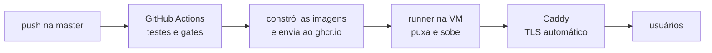

# Ambiente e deploy

## Variáveis de ambiente

Copie `.env.example` para `.env` e preencha. A API **não sobe** sem `JWT_SECRET` e `TOKEN_ENC_KEY`
válidos — é uma recusa deliberada, para que ninguém rode com segredo em branco sem perceber.

### Obrigatórias

| Variável | O que é | Como obter |
|---|---|---|
| `DATABASE_URL` | Conexão PostgreSQL | O Compose local expõe o banco em `localhost:5433` |
| `JWT_SECRET` | Assina os tokens de sessão; mínimo 32 caracteres | `openssl rand -base64 48` |
| `TOKEN_ENC_KEY` | Cifra os tokens da Microsoft em repouso; exatamente 32 bytes | `openssl rand -base64 32` |
| `FRONTEND_URL` | Origem autorizada no CORS | `http://localhost:3000` em desenvolvimento |
| `ALLOWED_EMAIL_DOMAINS` | Domínios de e-mail aceitos no login | `catolicasc.edu.br,catolicasc.org.br` |

### Microsoft Entra ID

| Variável | Onde fica no portal |
|---|---|
| `AZURE_TENANT_ID` | Visão geral do registro de aplicativo |
| `AZURE_CLIENT_ID` | Visão geral do registro de aplicativo |
| `AZURE_CLIENT_SECRET` | Certificados e segredos — anote na criação, não é exibido de novo |
| `AZURE_REDIRECT_URI` | Autenticação; precisa bater **exatamente** com a URL registrada |

A URI de redirecionamento é a causa mais comum de falha no login: ela difere por ambiente
(`localhost`, homologação e produção) e as três precisam estar registradas no portal.

### OneDrive

| Variável | Padrão |
|---|---|
| `ONEDRIVE_BASE_FOLDER` | `Parcerias` |
| `ONEDRIVE_TEMPLATES_FOLDER` | `Templates` |
| `ONEDRIVE_CONTRACTS_FOLDER` | `Contratos` |
| `ONEDRIVE_CHANCELAS_FOLDER` | `Chancelas` |

**Produção e homologação precisam de pastas diferentes.** Se apontarem para a mesma, um teste em
homologação grava contrato no acervo real.

### E-mail

| Variável | Observação |
|---|---|
| `MAIL_TRANSPORT` | `auto` (Graph, depois SMTP, depois log), `graph` ou `smtp` |
| `SMTP_HOST` `SMTP_PORT` `SMTP_USER` `SMTP_PASS` `SMTP_FROM` | Só necessários fora do modo `graph` |

Com `auto` e nada configurado, o código de segundo fator vai para o log — suficiente para
desenvolver. **Esse degrau é desligado quando `NODE_ENV=production`**: em produção o código nunca
é escrito no log.

### Ajustes finos

| Variável | Padrão | O que controla |
|---|---|---|
| `PORT` | `4000` | Porta da API |
| `NODE_ENV` | `development` | `production` silencia o código 2FA no log |
| `CONTRACT_JOB_POLL_MS` | `2000` | Intervalo entre tentativas de geração |
| `CONTRACT_JOB_MAX_ATTEMPTS` | `3` | Tentativas antes de marcar o job como falho |

## Os três ambientes

| Ambiente | Onde roda | Banco | OneDrive |
|---|---|---|---|
| **Local** | Docker na máquina do desenvolvedor | Contêiner em `:5433` | Pasta pessoal ou de testes |
| **Homologação** | Mesma VM da produção, projeto Compose separado | Instância própria | Pastas de homologação |
| **Produção** | VM Oracle Cloud (camada sempre gratuita) | Instância própria | Pastas oficiais |

Produção e homologação usam **o mesmo** `docker-compose`, diferenciados por `-p` (nome do projeto)
e `--env-file`. Dois arquivos de composição divergem com o tempo; um só garante que validar em
homologação signifique alguma coisa.

```bash
docker compose -p parcerias-prod    --env-file .env.prod    up -d --build
docker compose -p parcerias-staging --env-file .env.staging up -d --build
```

## Publicação

O GitHub Actions constrói as imagens, publica no `ghcr.io` e aciona um **runner instalado na própria
VM**, que puxa as imagens e sobe os contêineres.



Não há deploy por SSH de propósito: isso exigiria guardar uma chave privada nos segredos do
repositório e deixar a porta 22 exposta. Com o runner local, a máquina busca o que precisa e nada
de fora recebe credencial de acesso ao servidor.

## Observabilidade

A API escreve log estruturado em JSON na saída padrão. O Promtail coleta, o Loki indexa e o Grafana
consulta. Cada requisição carrega um `request_id` que também aparece na trilha de auditoria — é o
que permite partir de uma linha de auditoria e chegar ao log completo daquela chamada.

## Verificação de saúde

```bash
curl https://<dominio>/health
```

A rota consulta o banco antes de responder. Um `/health` que apenas devolve "ok" sem tocar em nada
reporta saudável um processo que perdeu a conexão — já aconteceu aqui, e a correção foi justamente
fazer a verificação tocar o banco.

## Passo a passo da primeira publicação

O roteiro completo (conta Oracle, abertura de portas, DNS, registro das três URIs de redirecionamento,
criação dos segredos no GitHub e instalação do runner) está no runbook de deploy mantido fora do
repositório, por conter detalhes de infraestrutura da instituição.
