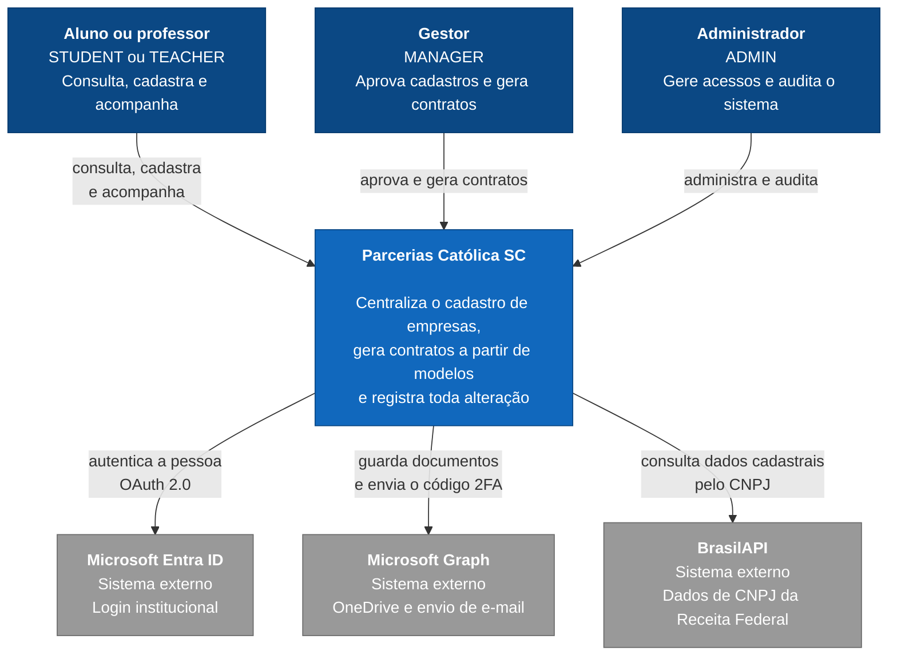
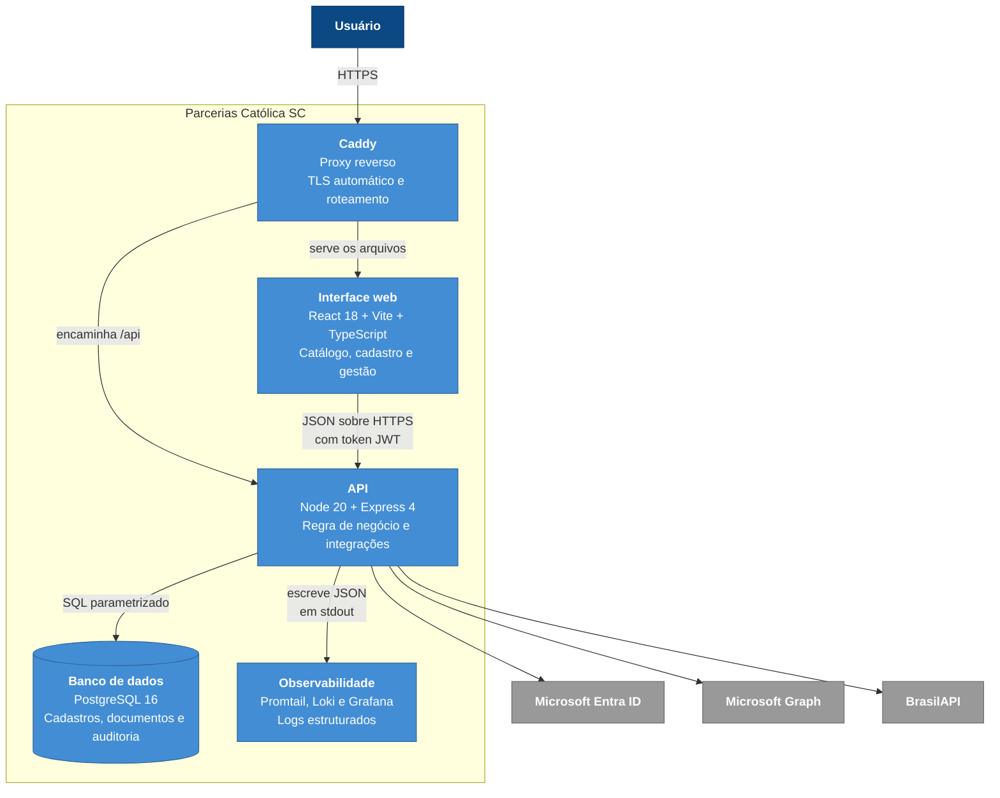
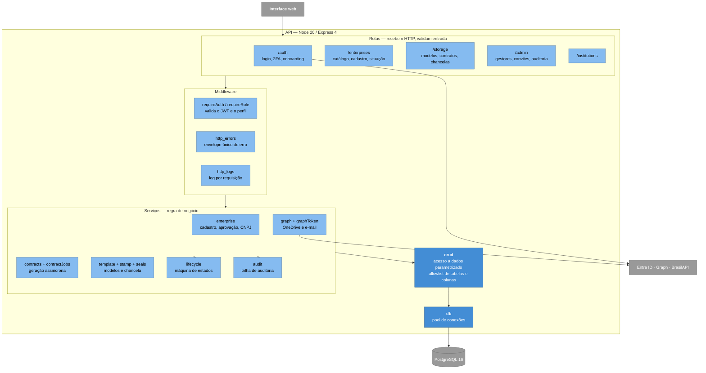
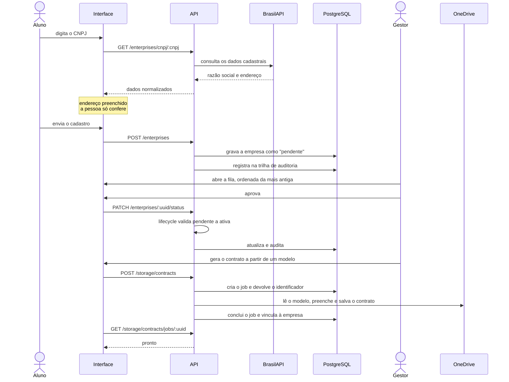

# Arquitetura C4

Os três primeiros níveis do [modelo C4](https://c4model.com/): contexto, contêineres e componentes.
Cada nível aumenta o zoom sobre o mesmo sistema — o nível 1 cabe numa conversa com a coordenação, o
nível 3 cabe numa conversa com quem vai mexer no código.

## Nível 1 — Contexto

Quem usa o sistema e com que sistemas externos ele conversa.

**Não há ator anônimo neste diagrama, e isso é proposital.** Todo acesso exige conta institucional
válida — inclusive o catálogo. As únicas rotas abertas são as quatro do fluxo de autenticação e a
verificação de saúde. A lista de parcerias traz dados de contato de empresas conveniadas, que são
dados cadastrais de terceiros e não material de divulgação.

**Por que três sistemas externos e não um banco de usuários próprio.** A instituição já tem
identidade centralizada no Entra ID e armazenamento no OneDrive corporativo. Reimplementar login e
guardar contrato em disco próprio criaria duas cópias da verdade e jogaria no TCC a responsabilidade
de proteger senha e documento jurídico. A consulta de CNPJ existe para que ninguém digite endereço
à mão — é o que transforma um formulário de doze campos em um campo mais conferência.

## Nível 2 — Contêineres

As partes que o sistema tem e como se falam.

**Por que a interface e a API são contêineres separados.** A interface é um conjunto de arquivos
estáticos: pode ser servida por qualquer coisa, escala sem estado e não precisa de Node em produção.
A API tem estado de conexão, segredos e integrações. Separar permite publicar uma correção visual
sem reiniciar a API — e foi o que permitiu, no deploy, reaproveitar a mesma composição de
contêineres para produção e homologação, mudando só o arquivo de variáveis.

## Nível 3 — Componentes da API

O interior do contêiner da API. As setas descem sempre: rota nunca fala com o banco, serviço nunca
monta SQL à mão.

**Por que `crud` é um gargalo proposital.** Toda consulta passa por um único módulo, que valida a
tabela e as colunas contra um allowlist, parametriza todos os valores e **recusa `UPDATE` ou
`DELETE` sem `WHERE`**. É uma restrição incômoda quando se quer uma consulta exótica, e foi
deliberada: um ponto único de passagem é o que torna possível afirmar que não há injeção de SQL em
lugar nenhum, em vez de auditar cada chamada. A regra do `WHERE` nasceu de um defeito real —
um valor `undefined` no filtro fazia a cláusula sumir e a operação atingir a tabela inteira.

**Por que `lifecycle` fica ao lado dos serviços e não dentro de cada um.** As transições válidas de
empresa, documento e assinatura são declaradas em tabelas num módulo só. Serviço que muda situação
chama `assertTransition` antes de escrever. Se a regra vivesse espalhada, cada caso de uso teria sua
própria ideia do que é permitido — e foi assim que um documento arquivado chegou a ser projetado
como assinado.

## Fluxo: do cadastro ao contrato assinado

A geração é assíncrona porque envolve várias idas ao OneDrive: ler o modelo, preencher, converter
para PDF e arquivar. Segurar a requisição aberta durante isso quebraria a cada rede lenta.
