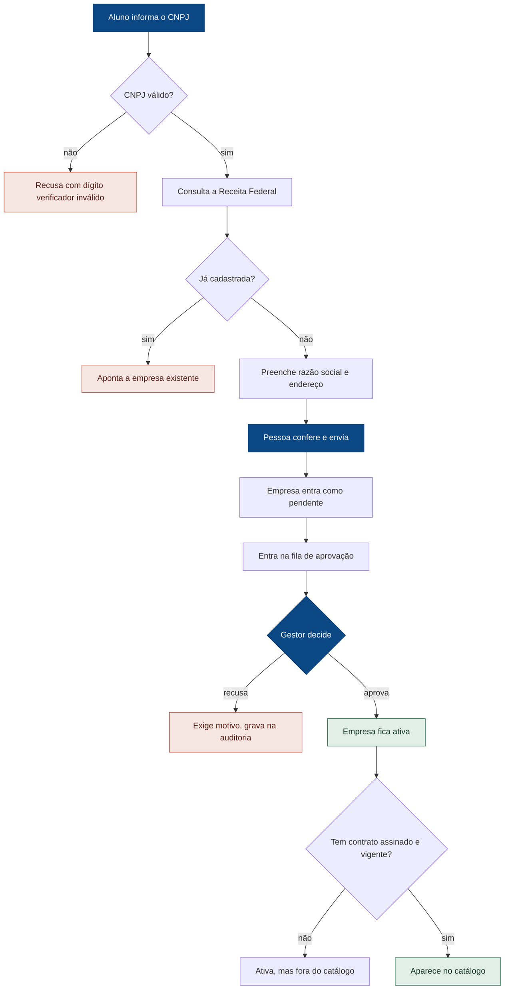
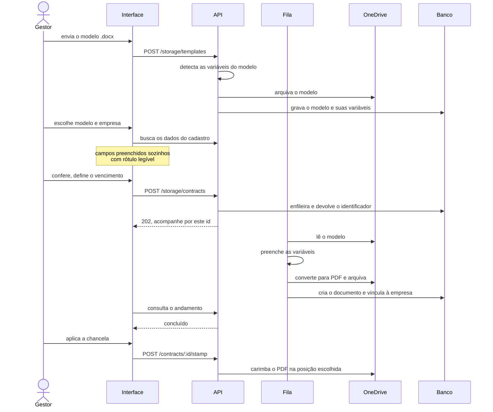
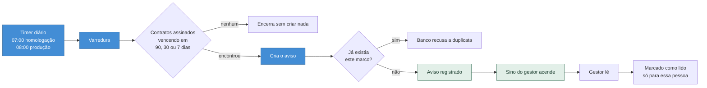

# Casos de uso e fluxos de negócio

Os três fluxos completos do sistema, do início ao fim, com os atores envolvidos e o que acontece
quando algo dá errado. Os requisitos que cada um exercita estão em
[Requisitos funcionais](Requisitos-funcionais).

## Atores

| Ator | Papel no fluxo |
|---|---|
| **Aluno ou professor** | Propõe empresas e acompanha os próprios cadastros |
| **Gestor** | Decide sobre cadastros, gera e administra contratos |
| **Administrador** | Controla acessos e audita o sistema |
| **Microsoft Entra ID** | Autentica a pessoa |
| **Microsoft Graph** | Guarda documentos no OneDrive e envia o código de acesso |
| **BrasilAPI** | Fornece os dados cadastrais a partir do CNPJ |

---

# Fluxo 1 — Da proposta à parceria vigente

**Objetivo:** registrar uma empresa parceira e colocá-la no catálogo com respaldo documental.

**Passo a passo**

1. A pessoa abre o cadastro e digita o CNPJ. A consulta dispara sozinha ao completar os 14 dígitos.
2. O sistema valida o dígito verificador **antes** de consultar — CNPJ inventado não chega à rede.
3. A BrasilAPI devolve razão social e endereço, que são normalizados e preenchidos.
4. Se já houver cadastro com aquele CNPJ, o erro aparece **junto do campo**, nomeando a empresa existente.
5. Opcionalmente anexa-se um documento.
6. A empresa é criada como **pendente** e entra na fila.
7. O gestor vê a fila ordenada pela espera, com destaque para quem aguarda há mais tempo.
8. Aprovar leva a **ativa**. Recusar exige **motivo escrito**, gravado na auditoria com origem e destino.

**O que torna este fluxo não trivial**

Aprovar não basta para aparecer no catálogo. A vitrine lista apenas empresas ativas **com contrato
assinado dentro da validade** — a regra `hasActiveContract`. Uma empresa aprovada sem contrato fica
visível à gestão, mas não à comunidade. É o que impede o catálogo de anunciar parceria que não existe
no papel.

**Quando dá errado:** CNPJ inválido, empresa duplicada, Receita Federal fora do ar (o cadastro segue
com preenchimento manual), e transição de situação não permitida, recusada com HTTP 409.

---

# Fluxo 2 — Do modelo ao contrato arquivado

**Objetivo:** produzir um contrato preenchido, convertê-lo em PDF, chancelá-lo e arquivá-lo no
OneDrive vinculado à empresa.

**Passo a passo**

1. O gestor envia um modelo `.docx`. O sistema **detecta as variáveis sozinho** — ninguém cadastra campos.
2. Ao gerar, escolhe o modelo e a empresa. Os campos que o cadastro conhece já vêm preenchidos, e cada um indica a origem.
3. Define o **vencimento**, que vem com 12 meses como padrão.
4. O pedido **entra numa fila** e a resposta é imediata, com um identificador.
5. Um trabalhador reivindica o pedido, lê o modelo no OneDrive, preenche, converte para PDF e arquiva.
6. O documento é criado no banco e vinculado à empresa.
7. Opcionalmente o gestor aplica a chancela institucional, posicionando-a sobre o PDF.

**O que torna este fluxo não trivial**

A geração é assíncrona **de propósito**. Montar um contrato envolve várias idas ao OneDrive — ler,
preencher, converter, arquivar. Segurar a requisição aberta durante tudo isso falharia a cada rede
lenta, e o usuário não saberia se devia esperar ou tentar de novo. A fila usa o próprio PostgreSQL,
com reivindicação exclusiva, sem exigir outra peça de infraestrutura.

**Quando dá errado:** o pedido é tentado novamente até três vezes; falha permanente marca o trabalho
como falho com a causa registrada. Token do OneDrive expirado devolve mensagem dizendo o que fazer,
não um erro genérico.

---

# Fluxo 3 — Do vencimento ao aviso

**Objetivo:** garantir que nenhum convênio expire sem que a gestão tenha sido avisada a tempo.

**Passo a passo**

1. Um agendador do sistema operacional dispara a varredura uma vez por dia.
2. Ela procura contratos **assinados e ativos** cujo vencimento cai exatamente em 90, 30 ou 7 dias.
3. Para cada um, cria um aviso. A unicidade por *(documento, marco)* está no banco.
4. O sino no cabeçalho mostra a contagem de **não lidos daquela pessoa**.
5. Ao abrir, o aviso é marcado como lido apenas para quem leu — os outros gestores continuam vendo o pendente.

**O que torna este fluxo não trivial**

A garantia de não duplicar está no **banco**, não na lógica: uma restrição de unicidade por documento
e marco. Isso significa que a varredura pode rodar duas vezes, o processo pode morrer no meio, ou
dois agendadores podem disparar juntos — e ainda assim o gestor recebe um aviso de cada tipo. Garantia
em código depende de ninguém errar; garantia no banco não.

O agendador roda **uma hora antes em homologação**, de propósito: um defeito aparece lá primeiro, com
tempo de reagir antes de produção.

**Quando dá errado:** se a máquina estiver desligada no horário, o `Persistent=true` faz a varredura
executar assim que ela religar, em vez de pular o dia. Uma varredura perdida é recuperada no dia
seguinte, porque a janela é diária e a duplicata é impossível.

---

## Rastreabilidade

| Caso de uso | Requisitos exercitados | Atores |
|---|---|---|
| Fluxo 1 — proposta à parceria | RF01, RF02, RF05, RF06, RF07, RF08 | Aluno, Gestor, Entra ID, BrasilAPI |
| Fluxo 2 — modelo ao contrato | RF10, RF11, RF12, RF13 | Gestor, Microsoft Graph |
| Fluxo 3 — vencimento ao aviso | RF14 | Gestor, agendador do sistema |
| Transversais | RF03, RF04, RF09, RF15, RF16 | Todos |
