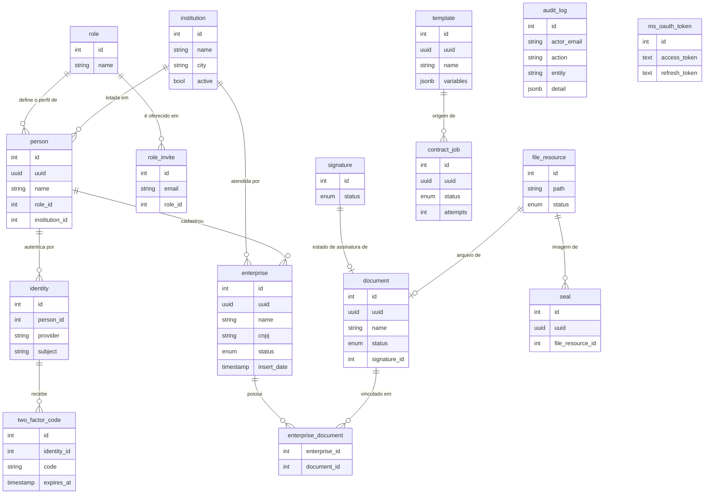
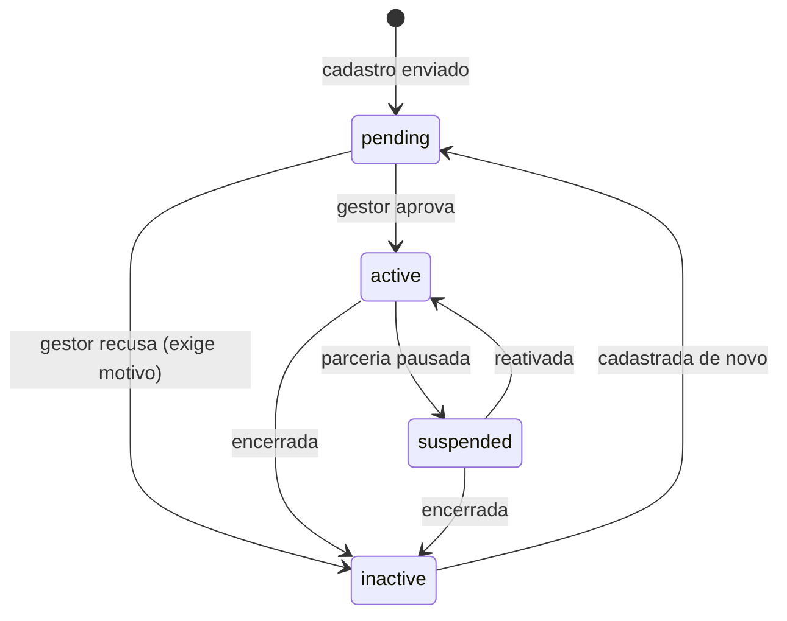
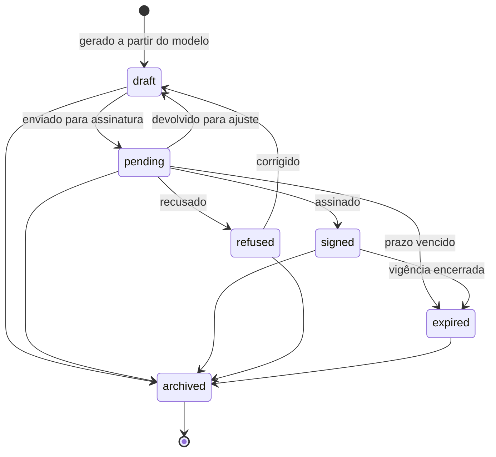
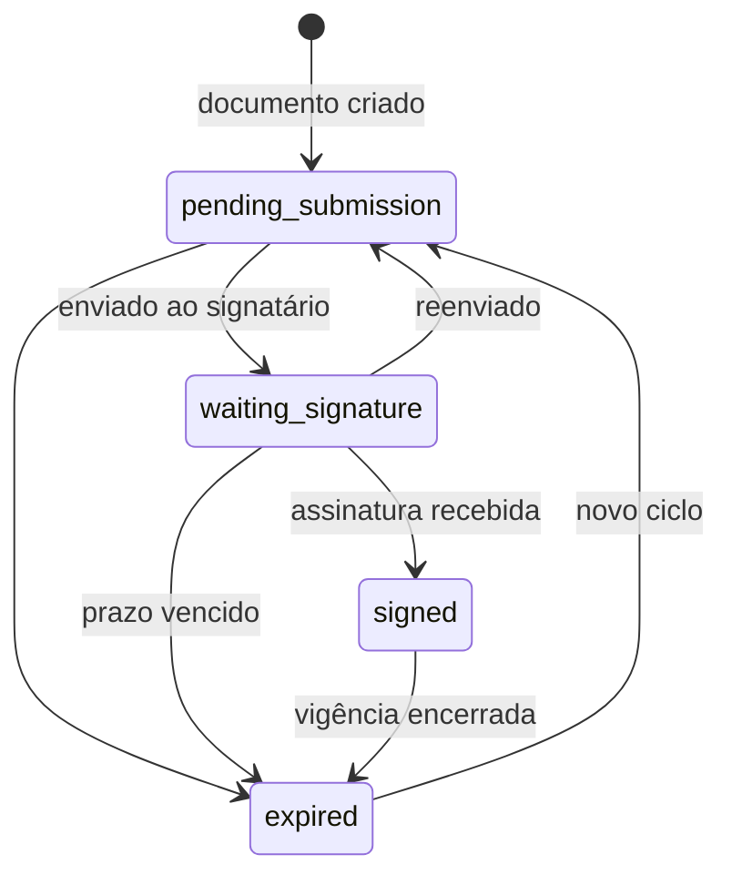

# Modelo de dados

Dezessete tabelas em PostgreSQL 16, criadas pela migration inicial em `server/migrations/`.
Toda alteração de schema passa por migration — nunca por DDL aplicado à mão.

## Visão geral



## Por que `person` e `identity` são tabelas diferentes

`person` é quem a instituição conhece: nome, perfil, lotação. `identity` é como essa pessoa se
autentica: provedor e identificador no provedor. Separar permite que a mesma pessoa tenha mais de
uma forma de entrar, e permite trocar de provedor de identidade sem reescrever a tabela de pessoas.
Também mantém o segundo fator (`two_factor_code`) preso à identidade usada no login, não à pessoa.

## Por que `document`, `file_resource` e `signature` são três tabelas

São três perguntas diferentes sobre a mesma coisa:

- **`document`** — o documento como objeto de negócio: é um contrato, tem nome e situação.
- **`file_resource`** — o arquivo: onde ele está e se o upload terminou.
- **`signature`** — o estado de assinatura: aguardando envio, aguardando assinatura, assinado.

Um documento pode existir antes do arquivo (rascunho) e o arquivo pode ser substituído sem que o
documento mude de identidade. Juntar os três numa tabela só obrigaria a inventar situações híbridas
do tipo "arquivo pronto mas assinatura pendente" dentro de uma coluna.

## Máquinas de estado

As transições válidas estão declaradas em `server/services/lifecycle.js`. Qualquer transição fora
destes diagramas vira **HTTP 409** com o par origem/destino na resposta, em vez de um registro
inconsistente. Permanecer no mesmo estado é sempre permitido, para que reenviar a mesma ação não
quebre nada.

### Empresa



Só `active` aparece no catálogo. Recusar leva a `inactive`, de onde só se volta por um novo
cadastro — é a ação mais irreversível da tela de gestão, e por isso é a única que exige motivo
escrito, gravado na trilha de auditoria junto com a transição.

### Documento



`archived` é terminal de propósito: documento arquivado não volta a circular. Antes disso existia um
defeito em que arquivar um rascunho o projetava como assinado — a máquina de estados foi o que
tornou esse caso impossível de representar.

### Assinatura



## Trilha de auditoria

`audit_log` guarda quem (`actor_uuid`, `actor_email`), o quê (`action`, `entity`, `entity_ref`),
quando (`insert_date`) e os detalhes em JSON (`detail`), além do `request_id` que liga o registro à
linha de log daquela requisição.

O campo `detail` é JSON justamente para absorver o que cada ação precisa sem migration nova. Uma
mudança de situação de empresa grava:

```json
{ "uuid": "…", "from": "pending", "to": "inactive", "reason": "CNPJ sem atividade na Receita Federal" }
```

Guardar `from` e `to` — e não só o valor final — é o que transforma a tabela de "o que mudou" em
"o que mudou, a partir de quê e por quê", que é o argumento central do trabalho.

## Enumerações

| Tipo | Valores |
|---|---|
| `enterprise_status` | `pending`, `active`, `suspended`, `inactive` |
| `document_status` | `draft`, `pending`, `signed`, `refused`, `expired`, `archived` |
| `signature_status` | `pending_submission`, `waiting_signature`, `signed`, `expired` |
| `file_status` | `uploaded`, `processing`, `ready`, `deleted` |
| `account_status` | `active`, `inactive`, `blocked`, `pending` |
| `job_status` | `queued`, `processing`, `done`, `failed` |

São tipos nativos do PostgreSQL, não `varchar` com convenção: valor fora da lista é recusado pelo
banco, não apenas pela aplicação.
